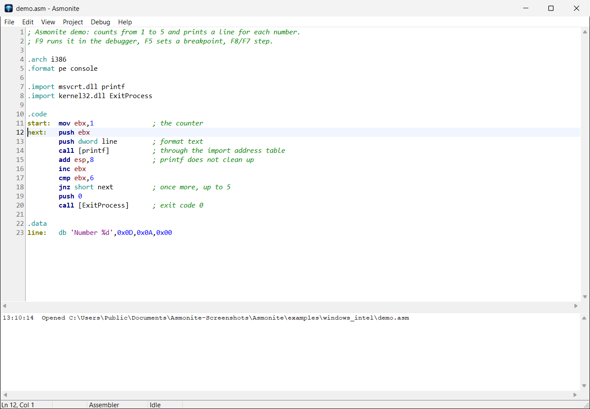
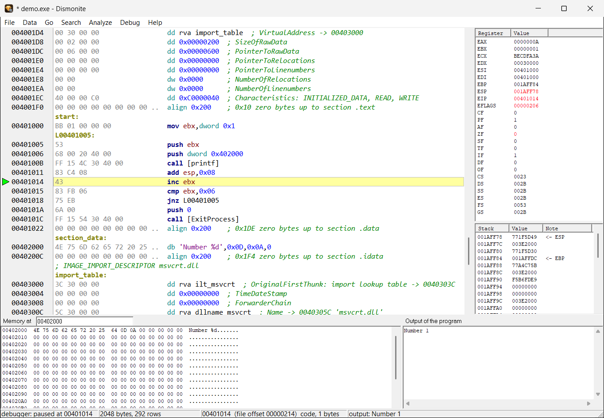

# Asmonite

Deutsch | [English](README.md)

**Asmonite** ist ein Assembler mit Editor und Debugger für Windows. **Dismonite** ist ein Disassembler
und Debugger, der vorhandene Programme liest. Beide sind kostenlos, laufen ohne Installation unter
Windows und arbeiten mit 32-Bit- und 64-Bit-Intel-Code, mit ARM, mit RISC-V (32 und 64 Bit) auf dem Raspberry Pi
Pico 2, dem ESP32-C3 und dem MangoPi MQ-Pro (Allwinner D1) und mit Xtensa auf dem ESP32-S3 und dem ESP32.

Aktuelle Version: **0.11.0** | Website: [asmonite.com](https://asmonite.com) und
[dismonite.com](https://dismonite.com) | Chat: [Discord](https://discord.gg/Sj8kvqEkc)



## Was es kann

**Asmonite** (Editor, Assembler, Debugger)
- Erzeugt echte Programme aus `.asm`-Dateien: Windows PE (x86, x64, ARM64, ARM32/Thumb-2) und DOS (`.com`, `.exe`).
- Syntax wie NASM/MASM in Intel-Schreibweise, dazu `func`, `call Name(args)`, `if` / `else` und `do ... while`
  für lesbaren Code. Unterschiede zu NASM: [docs/de/nasm-unterschiede.md](docs/de/nasm-unterschiede.md).
- **F1 erklärt die Zeile unter dem Cursor:** Syntax, Flags, Beispiel, die importierte Windows-Funktion mit
  ihren Parametern, DOS- und BIOS-Interrupts. Auf Deutsch und Englisch.
- Welche Befehlsgruppen jede Architektur hat und welche noch fehlen (AVX, die DSP-Erweiterung von Arm,
  Gleitkomma bei RISC-V ...): [docs/de/befehlssaetze.md](docs/de/befehlssaetze.md).
- Debugger: Breakpoints, Einzelschritt (über / hinein), bis zum Cursor, Register (Änderungen rot), Stack,
  Speicher, Watch-Fenster, Programmausgabe. Windows-Programme laufen auf diesem Rechner, x64 über einen
  Hilfsprozess, ARM-Programme auf einem Windows-on-ARM-Rechner, DOS-Programme in QEMU mit FreeDOS.
- **Raspberry Pi Pico 2 und Pico:** RISC-V (Hazard3) und Arm (Cortex-M33, Cortex-M0+) mit `.target pico2` /
  `.target pico`; F7 schreibt das Programm über eine CMSIS-DAP-Debug-Probe ins RAM oder in den Flash und
  debuggt es, **ohne OpenOCD**; UF2-Dateien für das BOOTSEL-Laufwerk. Anleitung: [docs/de/riscv-pico2.md](docs/de/riscv-pico2.md).
  Den Pico (RP2040) auch **ohne Debug-Probe**: ein Programm im RAM über seinen USB-Boot (BOOTSEL), ein Kabel.
  Anleitung: [docs/de/picoboot.md](docs/de/picoboot.md).
- **ESP32-C3:** RISC-V mit `.target esp32c3`; F7 lädt das Programm über den USB-Anschluss des Chips ins RAM oder
  schreibt es in den Flash und debuggt es, **mit einem Kabel, ohne Debug-Probe**. Anleitung: [docs/de/esp32c3.md](docs/de/esp32c3.md).
- **STM32F103 (Blue Pill):** Arm Cortex-M3 mit `.target stm32f103`; F7 lädt das Programm über dieselbe Debug-Probe wie
  beim Pico ins RAM oder schreibt es in den Flash und debuggt es. Beispiele: `examples/stm32/`.
- **ESP32-S3:** Xtensa LX7 mit `.arch xtensa` und `.target esp32s3`; F7 lädt das Programm über den USB-Anschluss des
  Chips ins RAM oder schreibt es in den Flash und debuggt es, **mit einem Kabel, ohne Debug-Probe**. Anleitung:
  [docs/de/esp32s3.md](docs/de/esp32s3.md).
- **ESP32:** Xtensa LX6 mit `.arch xtensa` und `.target esp32`; F9 lädt das Programm über den USB-Seriell-Chip des
  Boards ins RAM oder schreibt es in den Flash und debuggt es mit einem kleinen Monitor von Asmonite, **ohne
  JTAG-Probe**. Anleitung: [docs/de/esp32.md](docs/de/esp32.md).
- **MangoPi MQ-Pro (Allwinner D1):** RISC-V mit 64 Bit (`.arch riscv64`, `.target d1`); F9 lädt das Programm über USB
  (den FEL-Modus des Boot-ROMs) und debuggt es, **mit einem Kabel, ohne JTAG**. Anleitung: [docs/de/d1.md](docs/de/d1.md).
- Übersetzt auch eine kleine C-Teilmenge (`asmonite_cc`, abgeleitet von OTCC) und debuggt sie zeilenweise.

**Dismonite** (Disassembler, Debugger)
- Öffnet Windows- (PE: x86, x64, ARM, ARM64), DOS- (MZ) und ARM-Linux-Programme (ELF).
- Folgt dem Code ab dem Einsprung, lässt dich Code und Daten markieren, kommentieren und speichert das neben dem Programm.
- **Exportiert das Ergebnis als `.asm`**, das Asmonite wieder zu derselben Datei zusammensetzt, Byte für Byte.
- Debuggt das Programm, mit derselben Befehlsinfo.



## Download

Die ZIP-Datei gibt es auf der Seite [Releases](../../releases) und auf [asmonite.com](https://asmonite.com).
Irgendwo entpacken und `Asmonite.exe` oder `Dismonite.exe` starten; es gibt nichts zu installieren.
Zur ZIP-Datei gehört eine SHA-256-Prüfsumme.

Kleine unsignierte Programme werden von Virenscannern wegen ihrer Heuristik manchmal gemeldet.
Mit den Prüfsummen lässt sich nachprüfen, dass die Datei die veröffentlichte ist.

## Was in diesem Repository liegt

| Ordner | Inhalt |
|--------|--------|
| [`docs/`](docs) | Anleitungen und die Unterschiede zu NASM, auf Deutsch und Englisch |
| [`reference/`](reference) | Die Befehlsinfo der Programme (F1) als Text: x86, x64, ARM, ARM64, RISC-V, Windows-API, DOS |
| [`examples/`](examples) | Beispielprogramme: Windows (Intel, ARM), DOS, Raspberry Pi Pico 2 und Pico, ESP32-C3, ESP32-S3, STM32F103, `func` / `if` / Schleifen, ein C- und ein Pascal-Beispiel |
| [`CHANGELOG.md`](CHANGELOG.md) | Was sich in welcher Version geändert hat |

Die Programme selbst liegen in der ZIP-Datei der Releases, nicht in diesem Repository.

## Beispiel

```
.format pe console
.arch i386
.import msvcrt.dll cdecl printf
.import kernel32.dll ExitProcess

.code
start:
    call [printf](text)
    call [ExitProcess](0)

.data
text db 'Hello from Asmonite', 10, 0
```

In Asmonite öffnen und **F9** drücken: Das Programm wird neben der Quelle gebaut und im Debugger gestartet.

## Lizenz

Frei nutzbar, privat und gewerblich; siehe [LICENSE.txt](LICENSE.txt). Deine eigenen Programme gehören dir.

Copyright (c) 2026 Nils Belde
