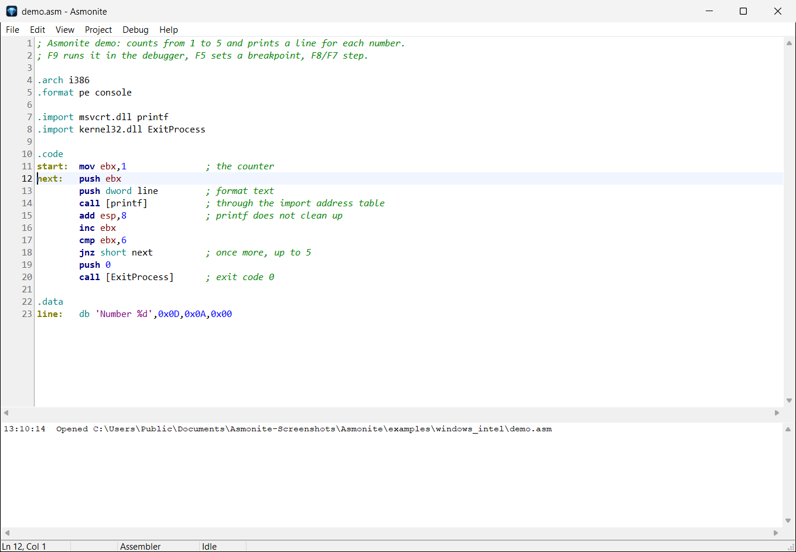
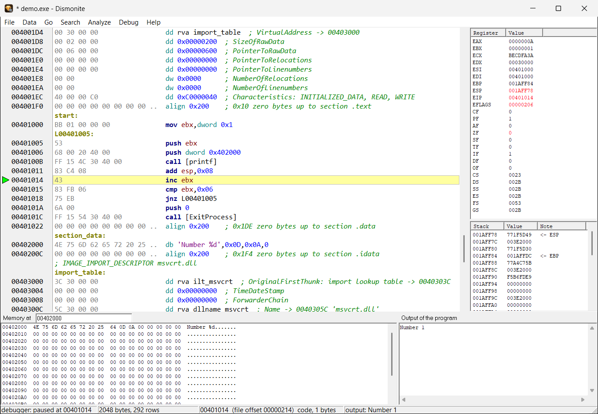

# Asmonite

[Deutsch](README.de.md) | English

**Asmonite** is an assembler with an editor and a debugger for Windows. **Dismonite** is a disassembler
and debugger that reads existing programs. Both are free, run on Windows without an installer, and
work with 32-bit and 64-bit Intel code, with ARM and with RISC-V on the Raspberry Pi Pico 2.

Current version: **0.9.0** | Website: [asmonite.com](https://asmonite.com) and
[dismonite.com](https://dismonite.com) | Chat: [Discord](https://discord.gg/Sj8kvqEkc)



## What it does

**Asmonite** (editor, assembler, debugger)
- Writes real programs from `.asm` files: Windows PE (x86, x64, ARM64, ARM32/Thumb-2) and DOS (`.com`, `.exe`).
- Syntax like NASM/MASM in Intel notation, plus `func`, `call Name(args)`, `if` / `else` and `do ... while`
  for readable code. Differences to NASM: [docs/en/nasm-differences.md](docs/en/nasm-differences.md).
- **F1 explains the line under the cursor:** syntax, flags, example, the imported Windows function with its
  parameters, DOS and BIOS interrupts. In English and German.
- Debugger: breakpoints, step over / into, run to cursor, registers (changes in red), stack, memory,
  watch window, program output. Windows programs run on this computer, x64 through a helper process,
  ARM programs on a Windows-on-ARM computer, DOS programs in QEMU with FreeDOS.
- **Raspberry Pi Pico 2 and Pico:** RISC-V (Hazard3) and Arm (Cortex-M33, Cortex-M0+) with `.target pico2` /
  `.target pico`; F7 writes the program into the RAM or the flash over a CMSIS-DAP debug probe and debugs it,
  **without OpenOCD**; UF2 files for the BOOTSEL drive. Guide: [docs/en/riscv-pico2.md](docs/en/riscv-pico2.md).
- **ESP32-C3:** RISC-V with `.target esp32c3`; F7 loads the program into the RAM or writes it into the flash over the
  USB port of the chip and debugs it, **with one cable, without a debug probe**. Guide: [docs/en/esp32c3.md](docs/en/esp32c3.md).
- Also compiles a small C subset (`asmonite_cc`, derived from OTCC) and debugs it line by line.

**Dismonite** (disassembler, debugger)
- Opens Windows (PE: x86, x64, ARM, ARM64), DOS (MZ) and ARM Linux (ELF) programs.
- Follows the code from the entry point, lets you mark code and data, add comments, and saves them next to the program.
- **Exports the result as `.asm`** that Asmonite assembles back to the same file, byte for byte.
- Debugs the program, with the same instruction help.



## Download

Get the ZIP from the [Releases](../../releases) page or from [asmonite.com](https://asmonite.com).
Unpack it anywhere and start `Asmonite.exe` or `Dismonite.exe`; there is nothing to install.
The ZIP file has a SHA-256 sum next to it.

Small unsigned programs are sometimes flagged by virus scanners because of their heuristics.
The sums let you check that the file is the one that was published.

## What is in this repository

| Folder | Content |
|--------|---------|
| [`docs/`](docs) | Guides and the differences to NASM, in English and German |
| [`reference/`](reference) | The instruction help of the programs (F1) as text: x86, x64, ARM, ARM64, RISC-V, Windows API, DOS |
| [`examples/`](examples) | Example programs: Windows (Intel, ARM), DOS, Raspberry Pi Pico 2 and Pico, ESP32-C3, `func` / `if` / loops, a C and a Pascal sample |
| [`CHANGELOG.md`](CHANGELOG.md) | What changed in each version |

The programs themselves are in the release ZIP, not in this repository.

## Example

```
.format pe console
.arch i386
.import msvcrt.dll cdecl printf
.import kernel32.dll ExitProcess

.code
start:
    call [printf](text)
    call [ExitProcess](0)

.data
text db 'Hello from Asmonite', 10, 0
```

Open it in Asmonite, press **F9**: the program is built next to the source and started in the debugger.

## License

Free to use, privately and commercially; see [LICENSE.txt](LICENSE.txt). Your own programs belong to you.

Copyright (c) 2026 Nils Belde
